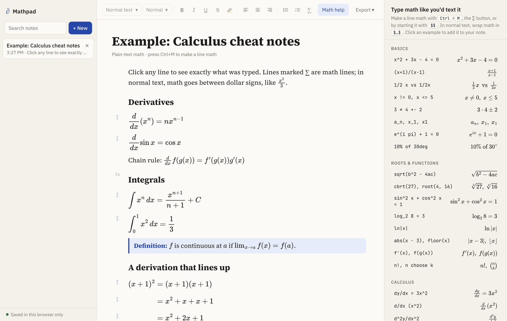
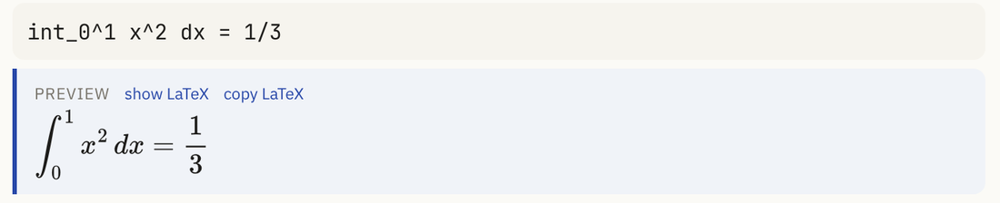

# ∂ Mathpad

**Math notes without the LaTeX.** Type math the way you'd text it (`x^2/3`, `int_0^1 x^2 dx`, `lim x->0 sin(x)/x`) and it turns into real notation as you type.



LaTeX looks great but is slow to write during a lecture. Plain text is fast but unreadable later. Mathpad lets you type the fast version and read the good version. When you need real LaTeX, for Overleaf or a problem set, it exports that too.

## Get it

- **Windows:** download `Mathpad-Setup-x.y.z.exe` from the [latest release](../../releases/latest) and run it. It works offline, notes stay on your computer, and **it updates itself** whenever a new release comes out.
- **In a browser:** if this repo has GitHub Pages turned on, the web version is at `https://<username>.github.io/<repo>/`. It works on any computer or phone, and notes are saved in that browser.

> **"Windows protected your PC"?** The installer isn't code-signed (that costs money every year), so Windows warns about it the first time. Click **More info → Run anyway**.

## Features

- **Live preview.** Click a line to edit what you typed; click away and it shows as math.

  

- **Math lines and inline math.** Whole lines can be math, or you can drop `$...$` into a sentence.
- **Derivations that line up.** Start a math line with `=` and it lines up under the `=` of the line above.
- **A cheat sheet built in.** The *Math help* panel shows every pattern with a live preview. Click one to add it to your note.
- **Docs-style formatting.** A toolbar with headings, text size, **bold**, *italic*, <u>underline</u>, ~~strikethrough~~, highlight, left/center/right alignment, and bulleted or numbered lists, using the same keyboard shortcuts as Google Docs. There are also labelled boxes for `Definition:`, `Theorem:`, `Proof:` and `Example:`.
- **Export.** Copy or save a note as a full LaTeX document (with `align*` for derivations) or as Markdown that works in Obsidian, Notion and GitHub.
- **Backups.** Save every note into one `.json` file, and import it on another computer or in the other version.
- **Updates itself.** The Windows app checks this repo's Releases when it starts (and every few hours), downloads new versions in the background, and asks you to restart. You can also use **File → Check for updates…**.
- **Private.** Your notes are never sent anywhere. The only network request is the update check to GitHub. Light and dark mode follow your system setting.

## How to type math

Make a line math with **Ctrl+M**, the **Tx / ∑** button beside it, or by starting the line with `$$`. In normal text, put math between dollar signs: `the area is $pi r^2$`.

### Basics

| You type | You get |
|---|---|
| `x^2 + 3x - 4 = 0` | $`x^{2} + 3x - 4 = 0`$ |
| `(x+1)/(x-1)` | $`\frac{x + 1}{x - 1}`$ |
| `1/2 x` | $`\frac{1}{2} x`$ |
| `1/2x` | $`\frac{1}{2x}`$ |
| `x != 0`, `x <= 5`, `+-` | $`x \ne 0,\; x \le 5,\; \pm`$ |
| `3 * 4` | $`3 \cdot 4`$ |
| `a_n`, `x1` | $`a_{n},\; x_{1}`$ |
| `e^(i pi)` | $`e^{i \pi}`$ |
| `30deg` | $`30^{\circ}`$ |
| `alpha, beta, theta, Delta` | $`\alpha,\; \beta,\; \theta,\; \Delta`$ |

### Roots and functions

| You type | You get |
|---|---|
| `sqrt(b^2 - 4ac)` | $`\sqrt{b^{2} - 4ac}`$ |
| `cbrt(27)`, `root(4, 16)` | $`\sqrt[3]{27},\; \sqrt[4]{16}`$ |
| `sin^2 x + cos^2 x = 1` | $`\sin^{2} x + \cos^{2} x = 1`$ |
| `log_2 8 = 3` | $`\log_{2} 8 = 3`$ |
| `abs(x - 3)` or `\|x - 3\|` | $`\lvert x - 3 \rvert`$ |
| `floor(x)`, `ceil(x)` | $`\lfloor x \rfloor,\; \lceil x \rceil`$ |
| `f'(x)` | $`f'(x)`$ |
| `n!`, `n choose k` | $`n!,\; \binom{n}{k}`$ |

### Calculus

| You type | You get |
|---|---|
| `dy/dx` | $`\frac{dy}{dx}`$ |
| `d/dx (x^2)` | $`\frac{d}{dx} (x^{2})`$ |
| `d^2y/dx^2` | $`\frac{d^{2}y}{dx^{2}}`$ |
| `partial f/partial x` | $`\frac{\partial f}{\partial x}`$ |
| `int x^2 dx` | $`\int x^{2}\,dx`$ |
| `int from 0 to 1 x^2 dx` or `int_0^1 x^2 dx` | $`\int_{0}^{1} x^{2}\,dx`$ |
| `lim x->0 sin(x)/x` | $`\lim_{x \to 0} \frac{\sin(x)}{x}`$ |
| `lim x->0+ ln x` | $`\lim_{x \to 0^{+}} \ln x`$ |
| `lim of (1 + 1/n)^n as n -> inf` | $`\lim_{n \to \infty} \left( 1 + \frac{1}{n} \right)^{n}`$ |
| `sum i=1 to n i^2` | $`\sum_{i = 1}^{n} i^{2}`$ |
| `sum_(k=0)^inf x^k/k!` | $`\sum_{k = 0}^{\infty} \frac{x^{k}}{k!}`$ |

### Sets, logic and vectors

| You type | You get |
|---|---|
| `x in RR` (also `ZZ`, `NN`, `QQ`, `CC`) | $`x \in \mathbb{R}`$ |
| `A union B`, `A intersect B` | $`A \cup B,\; A \cap B`$ |
| `x > 0 implies x^2 > 0` | $`x > 0 \implies x^{2} > 0`$ |
| `vec(v) = <1, 2, 3>` | $`\vec{v} = \langle 1, 2, 3 \rangle`$ |
| `u dot v`, `u cross v` | $`u \cdot v,\; u \times v`$ |
| `A^T`, `A^-1`, `det(A)` | $`A^{T},\; A^{-1},\; \det(A)`$ |

**Matrices:** commas between entries, semicolons between rows. `A = [1, 2; 3, 4]` gives

```math
A = \begin{bmatrix}1 & 2 \\ 3 & 4\end{bmatrix}
```

**Piecewise functions:** `f(x) = {x^2 if x > 0; 0 otherwise}` gives

```math
f(x) = \begin{cases}x^{2} & \text{if } x > 0 \\ 0 & \text{otherwise}\end{cases}
```

### Rules for the ambiguous cases

Plain text can mean more than one thing, so Mathpad follows a few fixed rules:

- **A space ends a fraction.** `1/2x` is $`\frac{1}{2x}`$, but `1/2 x` is $`\frac{1}{2}x`$.
- **An exponent takes one item.** `e^2x` is $`e^{2}x`$. Write `e^(2x)` to raise the whole thing.
- **Brackets around a whole part are dropped.** `(x+1)/(x-1)` shows no parentheses, so use them freely.
- **Sums and integrals:** if an upper limit has an operator in it, add `of` after it: `sum i=0 to n-1 of x_i`.
- **Words:** common words like `and`, `if`, `for` and `otherwise` stay as words. Put anything else in quotes: `"area" = l w`.
- **Escape hatch:** anything starting with `\` goes to LaTeX unchanged, e.g. `\mathcal{L}`.

## Formatting

The toolbar at the top works like Google Docs:

| Tool | Shortcut | What it does |
|---|---|---|
| Style menu | `Ctrl+Alt+0` … `3` | Normal text, Heading 1, 2 or 3 (or make the line math) |
| Size menu | `Ctrl+Shift+.` / `Ctrl+Shift+,` | Small, Normal, Large or Huge, for text or math |
| **B** *I* <u>U</u> ~~S~~ | `Ctrl+B` / `Ctrl+I` / `Ctrl+U` / `Alt+Shift+5` | Bold, italic, underline, strikethrough (press again to undo it) |
| Highlighter | | Highlight |
| Align buttons | `Ctrl+Shift+L` / `E` / `R` | Left, center, right, for text or math |
| List buttons | `Ctrl+Shift+8` / `Ctrl+Shift+7` | Bulleted / numbered list |
| ∑ | `Ctrl+M` | Make the line a math line |

Select some text and click a button, or click a button and then type. On a Mac use `⌘` instead of `Ctrl`.

Mathpad stores your notes as plain text, so the toolbar just inserts these marks for you, and you can type them yourself:

| Type | Get |
|---|---|
| `**bold**` | **bold** |
| `*italic*` | *italic* |
| `__underline__` | <u>underline</u> |
| `~~strike~~` | ~~strike~~ |
| `==highlight==` | highlighted text |
| `# Heading`, `## Heading`, `### Heading` | headings |
| `- item`, `1. item` | lists |

While you're editing a line you see the marks; click away and you see the formatted result. Alignment and size belong to the whole line and are saved with it. They carry over into LaTeX export (`center`, `flushright`, `\large`…) and Markdown export (`<div align="center">`).

## Keyboard shortcuts

| Key | What it does |
|---|---|
| `Enter` | New line (a math line continues as math) |
| `Enter` on an empty math line | Switch back to text |
| `Shift+Enter` | Line break inside the same block |
| `Ctrl+M` / `⌘+M` | Switch the line between text and math |
| `↑` `↓` | Move between lines |
| `Backspace` at the start of a math line | Turn it back into text |
| `Tab` / `Shift+Tab` in a list | Indent / outdent |
| `Ctrl+Z` / `Ctrl+Y` | Undo / redo (also undoes bold, headings and lists added from the toolbar) |

## Where your notes live

| Version | Stored in | Notes |
|---|---|---|
| Windows app | `%APPDATA%\Mathpad` | Updating or uninstalling keeps your notes. |
| Web app | That browser's storage for the site | Clearing site data deletes them, so back up now and then. |

The two versions don't sync. To move notes, use **Export → Back up all notes** in one and **Import notes…** in the other.

---

## For developers

### Project layout

```
src/app.html        the whole app: editor, notes list, cheat sheet, export (template)
src/mathparse.js    plain text -> LaTeX translator, no dependencies, runs in Node too
main.js             Electron entry point for the Windows app, including auto-update
scripts/build.js    fills the template -> docs/index.html (web) and app/ (desktop)
test/               translator tests
build/              app icon
docs/index.html     prebuilt web version for GitHub Pages
screenshots/        images used in this README
.github/workflows/  release.yml (Windows app + auto-update), pages.yml (web version)
```

### How the translator works

`src/mathparse.js` tokenizes the line, then runs a small recursive-descent parser with these precedence levels, from loosest to tightest:

1. relations (`=`, `<=`, `in`, `implies`, commas)
2. `+` and `-`
3. products (`*` or a space)
4. `/` fractions
5. "tight" products (things written with no space, like `2x`)
6. `^` `_` `!` `'`
7. atoms

Treating "space" and "no space" as different strengths is what makes `1/2x` and `1/2 x` mean different things. Big operators (`int`, `sum`, `lim`) read their own limits and body. Run-together words are split into known names, so `sinx` becomes `sin x`. Anything it can't parse still renders literally instead of failing.

Rendering uses [MathJax](https://www.mathjax.org/) with SVG output.

### Commands

Requires [Node.js](https://nodejs.org/) 20+.

```bash
npm install
npm test          # translator tests
npm start         # build and open the desktop app
npm run build     # rebuild docs/index.html and app/ after editing src/
npm run dist      # build the Windows installer into release/
```

`npm run dist` works out of the box on Windows. On macOS or Linux, install [Wine](https://www.winehq.org/) first (with 32-bit support).

### Releases and automatic updates

`.github/workflows/release.yml` runs on every push to `main` that changes the app. That includes files you upload or edit on github.com. It:

1. runs the tests (if they fail, nothing is released),
2. sets the version to `major.minor` from `package.json` plus the workflow run number (1.1.0 → 1.1.12 on run 12),
3. builds the installer on a Windows machine and publishes it as a GitHub Release, along with `latest.yml`, which installed apps read to find updates.

Installed copies use [electron-updater](https://www.electron.build/auto-update) to check that Releases page. New versions download in the background and install when you restart or close the app.

Things to know:

- **The repo must be public.** Installed apps read Releases without logging in, so a private repo's releases can't be seen.
- **Only builds made by the workflow update themselves.** They're the ones that know which repo they came from. A copy you build with `npm run dist` never updates.
- **Every push to `main` ships to every installed copy**, usually within a few hours. Treat `main` as "what my laptop runs", and test changes before you push them.
- Edits to only the README, screenshots or `docs/` don't make a release.
- To start a new version series, change `"version"` in `package.json` to e.g. `1.2.0`. Releases then count up from 1.2.x. Don't lower it: the updater only installs higher versions.
- You can also start a release by hand: **Actions → Release Windows app → Run workflow**.

### Publishing the web version

`.github/workflows/pages.yml` rebuilds the web version from `src/` and publishes it on every push. One-time setup: **Settings → Pages → Source: GitHub Actions**. It's then live at `https://<username>.github.io/<repo>/`.

### Adding new syntax

1. Add the word or rule in `src/mathparse.js`. Simple symbols go in the `SYMBOLS`, `REL_WORDS` or `BIN_WORDS` tables at the top.
2. Add an example and its expected LaTeX to `test/parser.test.js`.
3. Run `npm test`.
4. If it's worth showing users, add it to the `CHEAT` list in `src/app.html`.

## Credits

- [MathJax](https://www.mathjax.org/) (Apache 2.0) renders the math.
- [Electron](https://www.electronjs.org/) and [electron-builder / electron-updater](https://www.electron.build/) (MIT) run, package and update the desktop app.
- Fonts: [Source Serif 4](https://github.com/adobe-fonts/source-serif), [IBM Plex Sans](https://github.com/IBM/plex) and [JetBrains Mono](https://github.com/JetBrains/JetBrainsMono), all under the SIL Open Font License.

## License

MIT. See [LICENSE](LICENSE).
